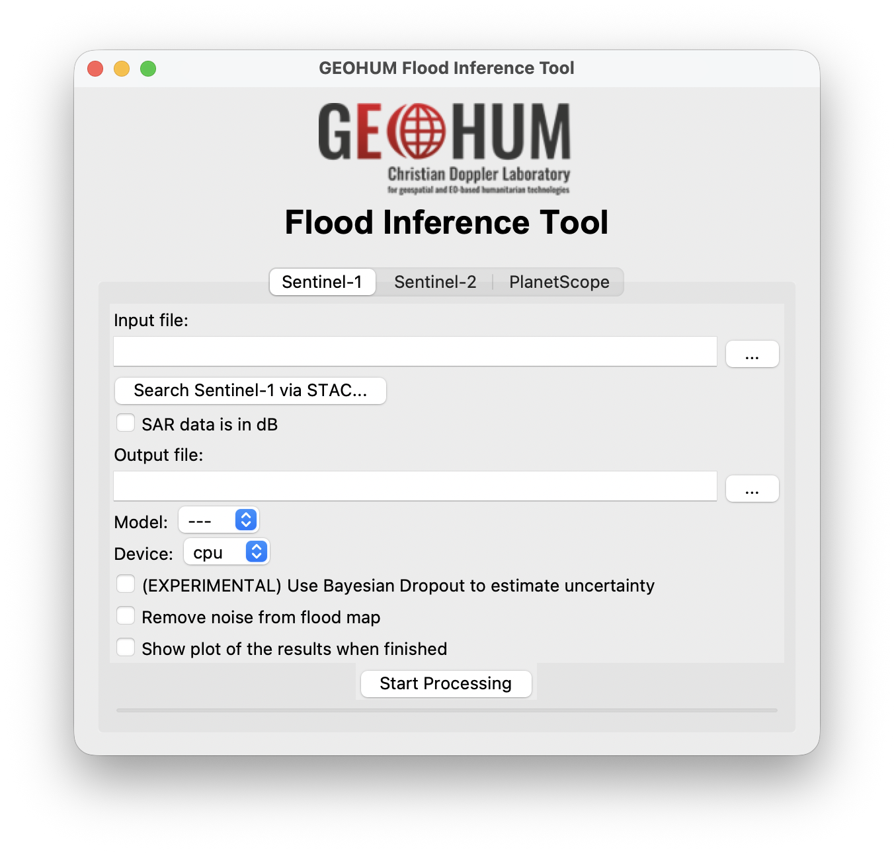
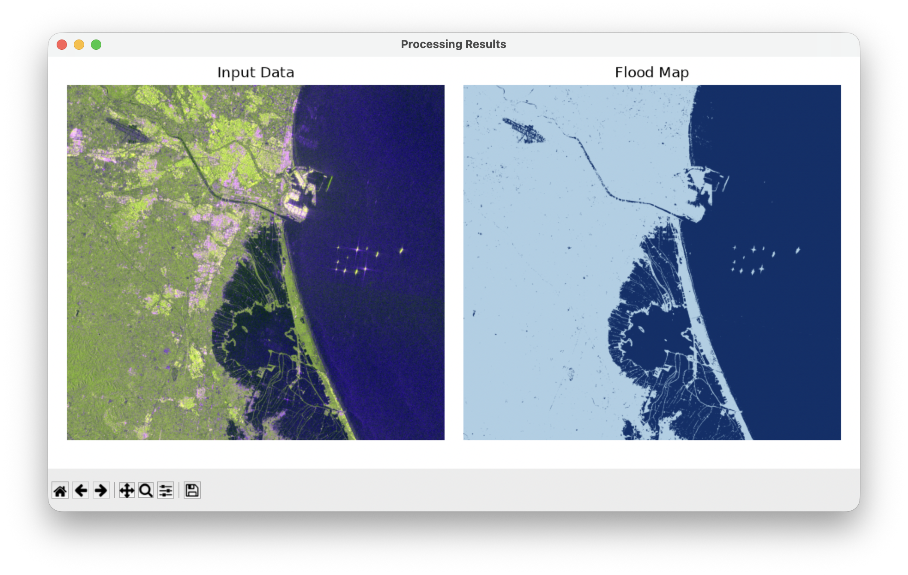
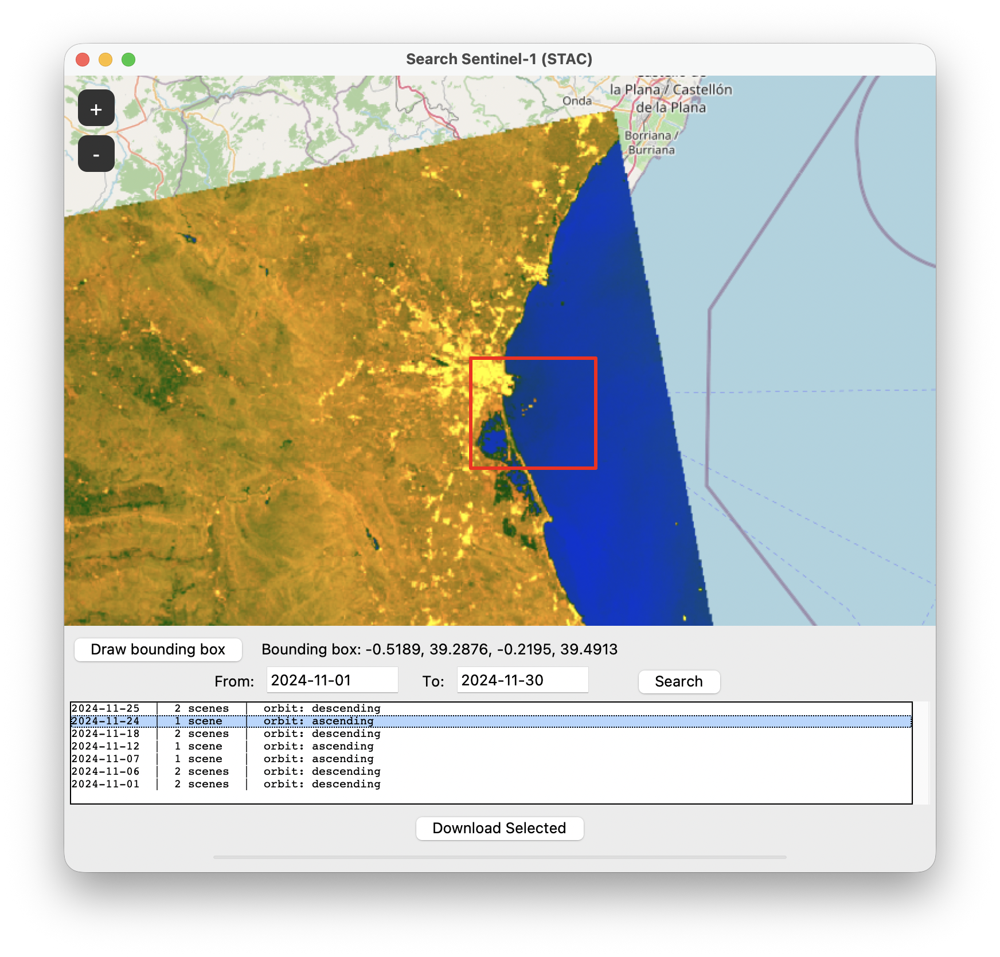

<p align="center"></p>

# Flood Inference Tool — User Manual

This manual explains how to install and use the Flood Inference Tool, a desktop application that produces flood/water maps from Sentinel-1, Sentinel-2, or PlanetScope imagery using trained deep-learning models (or, for Sentinel-1, a simpler Otsu thresholding method).

## Contents

1. [Installation](#1-installation)
2. [Launching the tool](#2-launching-the-tool)
3. [The graphical interface](#3-the-graphical-interface)
4. [Searching and downloading imagery online](#4-searching-and-downloading-imagery-online)
5. [Understanding the output file](#5-understanding-the-output-file)
6. [Command-line usage](#6-command-line-usage)
7. [Troubleshooting](#7-troubleshooting)

## 1. Installation

1. Get a copy of the repository, either with `git clone` or by downloading it as a `.zip` file and extracting it.
2. Install [Anaconda or Miniconda](https://www.anaconda.com/download/success) if you don't already have it.
3. Open a terminal (or the Anaconda Prompt on Windows) and move into the folder that contains `flood-inference-tool.py`:

   ```
   cd path/to/flood-inference-tool
   ```

4. Create the `flood_tool` environment and install all required packages:

   ```
   conda env create -f environment.yml
   ```

   This installs a GPU-enabled (CUDA) PyTorch on Windows and Linux, which supports NVIDIA GPUs from the GTX 16 / RTX 20-series up to the RTX 50-series (NVIDIA driver 580 or newer). For an older NVIDIA GPU (e.g. GTX 900/10-series or Titan V), use the legacy file instead, which supports those GPUs (and up to the RTX 40-series, but not the RTX 50-series):

   ```
   conda env create -f environment-legacy-gpu.yml
   ```

   Both work without a GPU too (processing then runs on the CPU, selected with the Device option), and on macOS, where Apple Silicon GPUs are available as `mps`. To check whether your GPU is usable, run `python -c "import torch; print(torch.cuda.is_available())"` in the activated environment; it should print `True`.

5. Activate it:

   ```
   conda activate flood_tool
   ```

If this finishes without errors, the tool is ready to use. The model weights aren't part of the repository: each model is downloaded automatically from [Hugging Face](https://huggingface.co/matosak/flood-inference-tool) the first time it is used (`WF2_unetv2_bgriswirs` comes from the [ml4floods](https://huggingface.co/isp-uv-es/ml4floods) repository instead), and cached locally afterwards. So each model's first run needs an internet connection and takes a little longer, especially for the two DOFA models (about 580 MB each); later runs work offline.

## 2. Launching the tool

From the same terminal (with the `flood_tool` environment activated), move into the repository folder and run:

```
python flood-inference-tool.py -ui
```

This opens the graphical interface. Running the script without `-ui` instead uses the command-line interface described in [section 6](#6-command-line-usage), which is meant for scripting or batch processing rather than everyday use.

## 3. The graphical interface

The window has three tabs — **Sentinel-1**, **Sentinel-2** and **PlanetScope** — one per supported data source. Each tab is self-contained and has the same overall layout: input file(s), a model dropdown, an output file, a few options, and a **Start Processing** button with a progress bar underneath it.



*Figure 1 — the PlanetScope tab, used here to illustrate the layout shared by all three tabs: input file field(s), a model dropdown, a device dropdown, the Bayesian Dropout and noise-removal checkboxes, and the Start Processing button with its progress bar. This screenshot predates two additions covered below — the "Show plot of the results when finished" checkbox ([3.1](#31-common-elements-across-tabs)) and the Sentinel-1/Sentinel-2 tabs' "Search via STAC..." button ([section 4](#4-searching-and-downloading-imagery-online)) — which appear in the current version but not in this image.*

### 3.1 Common elements across tabs

- **Input file fields**: type a path directly, or click the `...` button to browse for a file. On the Sentinel-2 tab, this button instead opens a small menu letting you choose between selecting a file or a folder (see [3.3](#33-sentinel-2-tab)).
- **Model**: a dropdown listing the models available for that data type (see each tab below for details). Processing cannot start until one is selected.
- **Device**: `cpu` is always available; `cuda` and `mps` appear automatically if a compatible GPU is detected (NVIDIA and Apple Silicon, respectively). GPU processing is substantially faster.
- **Output file**: where the result `.tif` file will be saved. Click `...` to pick a location.
- **(EXPERIMENTAL) Use Bayesian Dropout to estimate uncertainty**: runs the model 25 times with dropout active and keeps the per-pixel uncertainty alongside the usual prediction. This takes about 25× longer, is only meaningful for the neural-network models (not Otsu Thresholding), and changes the output file's structure — see [section 5](#5-understanding-the-output-file).
- **Remove noise from flood map**: a post-processing step that removes small, isolated specks from the classification (both small flood blobs sitting inside dry land, and small dry specks sitting inside flood water), merging them into whichever class surrounds them. Recommended for cleaner-looking maps; adds some extra processing time.
- **Show plot of the results when finished**: when checked, a window opens automatically once processing finishes, showing the input imagery next to the resulting flood map, so the result can be inspected without opening a separate GIS program.
- **Start Processing**: begins processing in the background; the button's own text shows the current stage (e.g. "Getting tiles...", "Doing the inference...") and the bar below it tracks progress. A dialog appears when the file has been saved.



*Figure 2 — the window opened by "Show plot of the results when finished", showing the input data (left) next to the resulting flood map (right). This example used the Sentinel-1 `DistanceMap.pt` model on a coastal scene; the toolbar at the bottom (pan, zoom, save) is matplotlib's own, and lets the figure be saved as an image file independently of the output GeoTIFF.*

### 3.2 Sentinel-1 tab

- **Input file**: a GeoTIFF with two bands, **VH then VV**, in that order (not reversible). If you prepared the image yourself from the raw `.zip` product, see the pre-processing steps required in SNAP (`S-1 Thermal Noise Removal`, `Calibrate`, `Range-Doppler Terrain Correction`) described in `README.md`; images from Google Earth Engine, or downloaded through this tool's own STAC search (see [section 4](#4-searching-and-downloading-imagery-online)), need no such pre-processing.
- **SAR data is in dB**: leave this **unchecked** if the file's VH/VV values are linear-scale backscatter (the usual case, including files downloaded via this tool's STAC search). Check it only if the values are already in decibels.
- **Model**:
  - `UNet-S1.pt` — the tool's main Sentinel-1 flood-mapping model.
  - `DistanceMap.pt` — a variant that also incorporates terrain slope and an internal distance-to-water estimate. It automatically downloads a Copernicus 30m DEM covering the scene the first time it runs for a given input, so it needs an internet connection and is noticeably slower ("Downloading DEM..." is shown while this happens).
  - `Otsu_Threshold` — a simple, non-machine-learning method that automatically picks a brightness threshold on the VH band to separate water from land. Fast, but generally less accurate than the neural-network models, and most useful as a quick sanity check or fallback.

### 3.3 Sentinel-2 tab

- **Input file or .SAFE folder**: either
  - a single GeoTIFF with 6 bands, in order **blue, green, red, nir, swir16, swir22**, with an optional 7th band carrying Sentinel-2's Scene Classification Layer (SCL) — if present, cloud and cloud-shadow pixels are automatically masked out of the result; or
  - a Sentinel-2 Level-2A `.SAFE` product folder (as distributed by Copernicus), from which the required bands — and the SCL cloud mask — are read automatically, at their native resolution.

  Click `...` to choose; it opens a small menu to pick either a file or a folder.
- **Model**:
  - `UNet-S2.pt` — this project's own Sentinel-2 flood-mapping model.
  - `WF2_unetv2_bgriswirs` — a model from the [ml4floods](https://huggingface.co/isp-uv-es/ml4floods) project. Unlike the other models, it produces four classes rather than three, since it detects clouds itself (see [section 5](#5-understanding-the-output-file)). Like the other models, its weights are downloaded automatically the first time it is selected.
  - `dofa_v2_base_seg_upernet_s2.pt` — a DOFA v2 foundation-model encoder with a UPerNet decoder, trained with the DOFA-transferability project on Sen1Floods11 (weak labels, then hand labels). It uses only the blue, green, red and NIR bands (B2, B3, B4, B8). It reached a water IoU of 82.7 on the Sen1Floods11 test set, and 39–52 on the FloodPlanet evaluation, where it was precise (94–99%) but missed part of the water. It is a large model, so it runs much faster on a GPU (`cuda`) than on the CPU.
- There is no dB option on this tab (it does not apply to optical imagery).

### 3.4 PlanetScope tab

- **Input file**: a PlanetScope image with bands named `blue`, `green`, `red`, `nir` (band order inside the file does not matter, as long as they are named; other bands, such as the extra bands of an 8-band SuperDove product, are ignored).
- **Input auxiliary file**: a raster whose first band is 0 for pixels to exclude (e.g. clouds or no-data areas) — this is used as the no-data/cloud mask for the result. Planet's `udm2` file works as-is, since its first band is the "clear" mask.
- **Model**:
  - `UNet-PlanetScope.pt` — this project's own PlanetScope model.
  - `dofa_v2_base_seg_upernet_PS.pt` — the DOFA v2 + UPerNet Sentinel-2 model described in [3.3](#33-sentinel-2-tab), further fine-tuned on FloodPlanet PlanetScope imagery (water IoU 67–70 on the FloodPlanet evaluation). Like that model, it runs much faster on a GPU. That imagery is a contrast-stretched 8-bit version of PlanetScope, so the tool stretches your image the same way first: the 1st–99th percentile range of the scene's valid pixels, shared by all four bands, becomes 0–255. Any PlanetScope product works, e.g. surface reflectance, regardless of its units. Since the stretch depends on the scene's contents, a scene that is almost entirely water or almost entirely bright (e.g. very cloudy, with clouds not masked) can give less reliable results.
- This tab has no STAC search button, since PlanetScope imagery isn't published on the public STAC catalogs this tool searches.

## 4. Searching and downloading imagery online

The Sentinel-1 and Sentinel-2 tabs each have a **"Search Sentinel-1/2 via STAC..."** button above the input field. This opens a separate window to find and download imagery directly from Microsoft's Planetary Computer catalog, without needing to source it elsewhere first.

1. **Draw a bounding box**: click "Draw bounding box", then click and drag on the map to mark your area of interest. The map can be panned and zoomed as usual beforehand to find the right place.
2. **Set a date range**: the "From"/"To" fields default to the last 30 days; edit them (as `YYYY-MM-DD`) to widen or narrow the search. For Sentinel-2, a maximum cloud cover percentage can also be set.
3. **Click Search**. Results are grouped by acquisition date: if several scenes from adjacent tiles or orbits cover your area on the same date, they appear as a single row (e.g. `2024-02-29 | 2 scenes | mean cloud cover: 47.8%`), and will be downloaded and merged together automatically. Selecting a row shows that date's scene(s) outlined on the map as a preview.
4. **Click "Download Selected"** and choose where to save the file. Only the pixels inside your drawn bounding box are downloaded (not the full scene(s)), windowed directly from the cloud-hosted imagery, so this is usually fast even for a large original scene. Once finished, the file path is filled in automatically in the corresponding tab's input field, ready to process.



*Figure 3 — the Sentinel-1 STAC search window: a bounding box drawn on the map, the "From"/"To" date range above the results list, and the results themselves grouped by acquisition date, with the number of scenes found and the orbit direction for each date (cloud cover is shown instead for Sentinel-2 searches, as described above). The highlighted row is the one currently selected, ready for "Download Selected".*

## 5. Understanding the output file

The output is a GeoTIFF with the same geographic footprint as the input. Its first (and, usually, only) band holds the classification, with `0` always meaning "no data" (outside the image's valid coverage, or masked out as cloud/cloud shadow for Sentinel-2):

| Model(s)                                   | 0        | 1    | 2     | 3     |
|---------------------------------------------|----------|------|-------|-------|
| `UNet-S1.pt`, `UNet-S2.pt`, `DistanceMap.pt`, `UNet-PlanetScope.pt`, `dofa_v2_base_seg_upernet_s2.pt`, `dofa_v2_base_seg_upernet_PS.pt`, `Otsu_Threshold` | no data | dry  | flood/water | — |
| `WF2_unetv2_bgriswirs`                      | no data | land | water | cloud |

If **Bayesian Dropout** was enabled, the file instead has two floating-point bands: the first is the model's prediction (same meaning as above) and the second is a per-pixel uncertainty estimate (higher values mean the model was less confident at that pixel).

The result can be opened in any standard GIS software (QGIS, ArcGIS, etc.) like any other GeoTIFF, or inspected directly with the **"Show plot of the results when finished"** option described in [3.1](#31-common-elements-across-tabs).

## 6. Command-line usage

For scripting or batch processing, the tool can be run without `-ui`:

```
usage: flood-inference-tool.py [-h] [-ui] [-i_s1 INPUT ...] [-i_s2 INPUT ...] [-i_ps INPUT INPUT]
                                [-o OUTPUT_PATH] [-pp] [-d DEVICE] [-m MODEL] [-dB] [-bd]

options:
  -h, --help                       show this help message and exit
  -ui, --ui-mode                   activate the graphical interface; ignores all other options
  -i_s1, --input_file_sentinel_1   path to the Sentinel-1 VH+VV GeoTIFF (in that band order)
  -i_s2, --input_file_sentinel_2   path to a Sentinel-2 GeoTIFF, or a .SAFE folder
  -i_ps, --input_files_planetscope two paths: the BGRN image, then the auxiliary/cloud-mask image
  -o, --output-path OUTPUT_PATH    where to save the resulting GeoTIFF
  -pp, --post-processing           remove small noise specks from the result (see 3.1)
  -d, --device DEVICE              "cpu", "cuda", or "mps" (default: "cpu")
  -m, --model MODEL                model file name, e.g. "UNet-S1.pt" or "Otsu_Threshold"
  -dB                               set if the Sentinel-1 input is already in decibels
  -bd, --bayesian-dropout          estimate per-pixel uncertainty (see 3.1); ~25x slower
```

Exactly one of `-i_s1`, `-i_s2`, `-i_ps` must be given, matching the data type of `-m`'s model.

Examples:

```
python flood-inference-tool.py -i_s1 path/to/image.tif -o path/to/flood-mask.tif -m UNet-S1.pt -pp -d cuda

python flood-inference-tool.py -i_s2 path/to/scene.SAFE -o path/to/flood-mask.tif -m WF2_unetv2_bgriswirs -d mps

python flood-inference-tool.py -i_ps path/to/bgrn.tif path/to/aux.tif -o path/to/flood-mask.tif -m UNet-PlanetScope.pt
```

The command-line interface does not include the STAC search window or the "show plot" option; both are graphical-interface-only features.

## 7. Troubleshooting

- **"Please select a model before starting the processing."** — pick an entry from the Model dropdown; processing cannot start while it's left at `---`.
- **STAC search button shows a "Missing dependency" error** — the `tkintermapview` package isn't installed; re-run the installation steps in [section 1](#1-installation).
- **Processing on `cuda`/`mps` isn't offered** — no compatible GPU was detected on this machine; `cpu` will always work, just more slowly.
- **A Sentinel-1 result looks unexpectedly inverted or much noisier than usual** — double-check the "SAR data is in dB" checkbox matches your input file's actual scale (see [3.2](#32-sentinel-1-tab)).
- **`DistanceMap.pt` is slow the first time** — it downloads a terrain elevation model for the scene's area automatically; this only happens once per input file and requires an internet connection.
